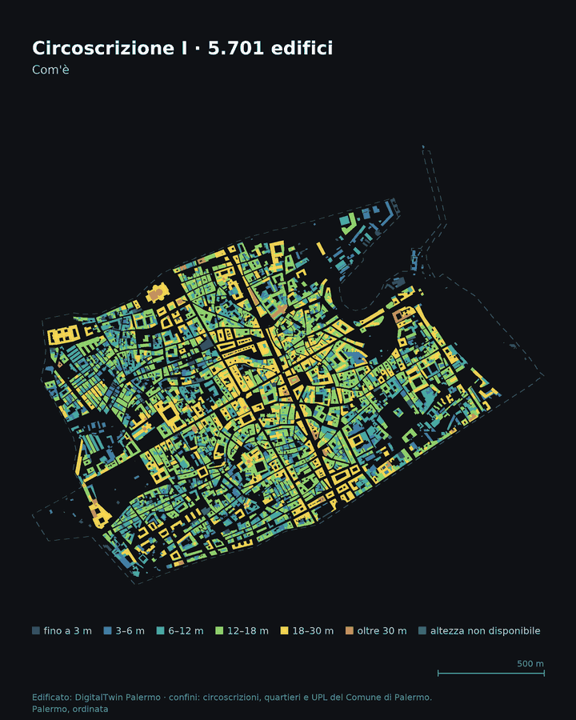

# Palermo, ordinata

Gli edifici di Palermo, zona per zona: colorati sulla mappa, poi "sollevati" e ordinati in righe dal più grande al più piccolo, alla stessa scala. Ispirato a [Paris, sorted](https://abenrob.github.io/30daymap2026/day-03-polygons/) di Adam Roberts (#30DayMapChallenge 2026, giorno 3, Poligoni). Tutti gli edifici sono visibili insieme su una base scura ([MapLibre GL](https://maplibre.org/) con [OpenFreeMap](https://openfreemap.org/)); gli edifici e le animazioni sono disegnati da zero in JavaScript e Canvas 2D. L'interfaccia segue lo stile di `potere_d'acquisto_reale` (speed-dial a sinistra, pannello a tab a destra).

## Come si usa

```
python3 -m http.server 8765
```

Poi apri `http://localhost:8765/`. Serve un server locale: `fetch` dei JSON non funziona da `file://`. Le anteprime social (`img/social-card.png`) si rigenerano con `python3 scripts/04_social_card.py`.

- **Viste (speed-dial a sinistra):** Mappa, con tutti i 111.478 edifici sulla base scura, e Ordinata, con un blocco per ogni zona del livello scelto, posto vicino alla posizione geografica della zona e con gli edifici dal più grande al più piccolo alla stessa scala. Il passaggio Mappa ⇄ Ordinata è animato (1,6 s).
- **Livello:** Circoscrizioni (8), Quartieri (25) o UPL (55), dallo speed-dial o dal pannello. Tutte le zone del livello sono visibili insieme.
- **Pannello a destra:** tab Zone (statistiche, ricerca, tre classifiche a barre per edifici, impronta a terra e mediana, con le barre di classe cliccabili come filtri), Metodologia, Utilità, Guida (screenshot) e Credits (fonti e ringraziamenti). Il pulsante «Torna su» riporta in cima al pannello.
- **Ricerca** (barra in basso): circoscrizione, quartiere, UPL o indirizzo. Con «via Maqueda 100» la mappa si centra sull'edificio più vicino al civico ANNCSU e lo evidenzia (aggancio approssimato: l'edificio più probabile). La scheda al passaggio del mouse mostra anche via e civici dell'edificio, in Mappa e in Ordinata.
- **Colore:** altezza, superficie dell'impronta oppure uso.
- **Zone:** un clic su una zona (mappa, blocco, mini-mappa o tabella) la seleziona e porta lì la vista; Esc o "Mostra tutta la città" la deseleziona.
- **Lotti catastali:** interruttore «Lotti» nella legenda (solo vista Mappa). Le 135.038 particelle di Palermo (Agenzia delle Entrate, G273, settembre 2026) sono colorate per rapporto di copertura, calcolato intersecando gli edifici con le particelle (un edificio conta in un lotto se almeno il 10% della sua impronta ci cade dentro; rapporto troncato a 100%). Clic su un lotto per la scheda, doppio clic per la vista Ordinata del lotto: contorno della particella con i suoi edifici nelle posizioni reali. Dati: `data/lotti.pmtiles` (tile vettoriali) e `data/lotti/` (legame edificio→lotto e contorni per UPL), calcolati da `scripts/09_lotti.py` (verifica: `scripts/verifica_lotti.py`). La legenda dei lotti è un filtro indipendente dal colore: clic su una classe di copertura mostra solo quei lotti e gli edifici che ci stanno dentro (colorati come al solito per altezza, superficie o uso), con layer, edifici e pannello sempre allineati; secondo clic ripristina, Maiusc+clic accende/spegne (`&y=` = classi spente). **Ordina per lotti** (interruttore nella legenda, `&ol=1`): nella vista Ordinata ogni zona mostra i suoi lotti in file per superficie, ognuno con il contorno della particella e i suoi edifici nelle posizioni reali, alla stessa scala (54.888 lotti con edifici + 212 edifici senza particella). L'interruttore «Edifici sui lotti» nasconde gli edifici lasciando solo le particelle (`&e=0`). Link: `&q=1` e `&lot=<k>`. Per provarlo in locale serve un server con supporto agli header Range (il `python -m http.server` non basta). Spiegazione e screenshot nei tab Guida (punto 10) e Metodologia (punto 9).
- **Autocorrelazione (LISA):** interruttore nella legenda o tab Moran. Sulle 55 UPL mostra Moran's I globale (con p da 9.999 permutazioni) e i cluster LISA locali: hotspot (alto-alto), coldspot (basso-basso) e outlier (alto tra bassi, basso tra alti), per altezza media, copertura del suolo, densità di edifici e, dai lotti catastali, lotto mediano, frammentazione (particelle/ha), quota di edifici a cavallo e quota di lotti non costruiti. Pesi: contiguità queen. Il p locale non è corretto per i test multipli. Dati in `data/moran.json`, calcolo in `scripts/08_moran.py`. Link: `&m=alt|cop|den|lmed|frag|cavq|vuoq`. Spiegazione e screenshot nei tab Guida (punto 9) e Metodologia (punto 8).
- **Mappa:** rotella o pinch per lo zoom, trascinamento per spostarsi, doppio clic nella vista Ordinata per tornare all'inquadratura. Il passaggio del mouse (o un tap) mostra uso, altezza, superficie e zona dell'edificio.
- **Tema e base:** scuro di default, chiaro dal pulsante dello speed-dial; base satellitare opzionale.
- **Link diretti:** `#l=circ|quar|upl&v=map|sorted&z=<id zona>`, ad esempio `#l=upl&v=sorted&z=upl-tribunali-o-kalsa`.

## Crediti

Idea e metodo: Adam Roberts, [30daymap2026 / day-03-polygons](https://github.com/abenrob/30daymap2026), che ha autorizzato l'adattamento del codice a Palermo (il repository originale non indica una licenza). Sviluppo: @gbvitrano con Claude (Anthropic).

## Struttura del codice

`js/geo.js` (UTM → lon/lat → Mercator), `js/layout.js` (impacchettamento a scaffali, invariato), `js/blocchi.js` (blocchi per zona), `js/citta.js` (caricamento del livello), `js/base.js` (MapLibre), `js/render.js` (canvas, animazione, LOD), `js/pannello.js` (pannello), `js/moran.js` (autocorrelazione), `js/app.js` (orchestrazione). Test: `node --test tests/*.test.js`. Il dato `data/index.json` contiene, per ogni zona, `ox` e `oy`, l'angolo SW della zona in decimetri dall'angolo SW della città (scritti da `scripts/02_export.py`).

## Dati

| Dato | Origine |
|---|---|
| Edifici | `DigitalTwin/dati/edifici/edificato.gpkg` (111.844 poligoni, EPSG:4326, con altezza e uso) |
| Confini | `palermo_popolazione/dati/geo_{circoscrizioni,quartieri,upl}.geojson` (EPSG:32632) |
| Isolati | [DPC Aggregati Strutturali ITG Isole](https://github.com/pcm-dpc/DPC-Aggregati-Strutturali-ITG-Isole), `Isole/Sicilia/Palermo/Palermo.shp` (46.852 aggregati, CC BY 4.0), elaborato da `scripts/07_isolati.py` in `data/isolati.json` |

### Fonti degli edifici

`edificato.gpkg` è il layer `edifici_unificati` del DigitalTwin Palermo (2026), una copia di `palermo_dtm_5m/dati/edificato.gpkg`. Unisce quattro fonti, scegliendo per ogni edificio la geometria più dettagliata:

| Fonte | Ruolo |
|---|---|
| Comune di Palermo, unità volumetriche della Carta Tecnica Comunale (rilievo 2006) | geometria, altezza, quote e volume (campo `source` = `volumetrie_ok`, 99.067 edifici) |
| Overture Maps Foundation | copertura globale |
| Global Building Atlas (DLR / TU München) | copertura globale da immagini satellitari |
| OpenBuildingMap (Awesome GEE Community Catalog, include Google Open Buildings) | copertura globale da deep learning |

Il campo `source` vale `Edificato_join_vol` (1.521 edifici) quando la geometria è globale con altezze comunali, e `Edificato` (11.256) quando manca il rilievo comunale. La documentazione completa è in `palermo_dtm_5m/dati/edifici_unificati_post_human.md`. L'origine del campo `occupancy` (uso) non è documentata.

**Licenza: da verificare.** Il DigitalTwin indica "CC BY 4.0" per il layer, ma la scheda delle fonti segna "licenza da verificare" per le unità volumetriche CTC, e i dati di Overture potrebbero avere condizioni proprie (ODbL, da controllare). Non pubblicare né ridistribuire i dati o le animazioni prima di averla chiarita.

### Avvertenze

- **L'85% degli edifici non ha un uso** (`UNK`). Per questo la colorazione di partenza è per altezza.
- Ogni edificio è assegnato alla UPL che contiene un suo punto interno; 14 edifici a più di 50 m da ogni UPL sono scartati.
- Gli edifici sotto i 5 m² (352) non sono mostrati. Le aree sono calcolate dalla geometria, non da `area_mq` (nulla in 11.256 righe).
- 1.796 edifici hanno altezza 0: sono nella classe "altezza non disponibile".
- La banca dati può spezzare un isolato in più edifici: i conteggi non sono unità catastali.
- **Isolati = aggregati strutturali del DPC**: gruppi di edifici contigui, non isolati delimitati da strade (mediana: 1 edificio). Ogni edificio va all'aggregato con la sovrapposizione maggiore, altrimenti al più vicino entro 3 m; 4.451 edifici (4%) restano senza isolato. Si esportano solo i 39.545 aggregati con almeno un edificio. Il livello si accende con «Isolati» nella legenda (solo vista Mappa); il doppio clic su un isolato apre la vista Ordinata del solo isolato, con statistiche e barre calcolate sui suoi edifici (`data/isolati.json`, campo `e`: edificio → isolato, indicizzato come `civici.json`; hash `a=<IDAG>`).
- Le impronte sono semplificate a 0,3 m.
- Le immagini sono in coordinate metriche locali, senza basemap: la rotazione dipende dalla griglia UTM 32N.

Dettagli della verifica in [`docs/FASE0.md`](docs/FASE0.md); piano e scelte in [`docs/PIANO.md`](docs/PIANO.md).

## Rigenerare i dati

Servono geopandas, shapely, pyogrio e Pillow. Nell'ambiente `qgis` di micromamba ci sono già:

```
export PROJ_DATA=$HOME/micromamba/envs/qgis/share/proj
PY=$HOME/micromamba/envs/qgis/bin/python
$PY scripts/00_verifica.py   # controllo dei dati (sola lettura)
$PY scripts/01_prep.py       # pulizia e assegnazione alle zone → data/work/
$PY scripts/02_export.py     # data/index.json e data/zone/*.json
$PY scripts/05_civici.py     # data/civici.json: indice dei civici per la ricerca
python3 scripts/06_perm_livelli.py  # data/perm-livelli.json: edifici circ/quar -> indice UPL (indirizzi nella scheda); da rilanciare dopo 05
```

`05_civici.py` aggancia ogni civico ANNCSU (164.742, 4.735 vie) all'edificio più vicino entro 25 m (99,4% agganciato, 36% dentro il poligono) e scrive l'indice caricato dalla ricerca alla prima digitazione. Legge i civici da `DigitalTwin/dati/civici-omi/civici/`.

Le soglie e le classi sono in `scripts/common.py`. Il formato di ogni edificio è descritto in testa a `scripts/02_export.py`.

## Struttura

```
index.html  css/style.css  js/layout.js  js/app.js
data/index.json  data/zone/<id>.json  data/civici.json  data/perm-livelli.json
scripts/  docs/  img/
```

`js/layout.js` contiene il packing a righe (ordinamento per area decrescente, spazio di 1,5 m, larghezza del contenitore `√(area × 1,12 × proporzione)`).

## Animazione

```
$PY scripts/03_make_animation.py upl-tribunali-o-kalsa   # frame PNG in frames/<id>/ (--ss 1 per bozze veloci)
scripts/make_gif.sh upl-tribunali-o-kalsa                # img/anim/<id>.mp4 e .gif
$PY scripts/test_layout.py js_layout.json                # confronto del packing con quello JS
```

Esempio: `img/anim/circ-i.gif`.



Il disegno usa Pillow e lo stesso layout dell'app; servono `ffmpeg` e, per Inter, la variabile `FONT_DIR` (altrimenti DejaVu Sans).


## Licenza

- **Codice** (`index.html`, `css/`, `js/`): [MIT](LICENSE). L'idea e il metodo derivano da [day-03-polygons](https://github.com/abenrob/30daymap2026/tree/main/day-03-polygons) di Adam Roberts, che ha autorizzato l'adattamento a Palermo; il repository originale non indica una licenza.
- **Dati** (`data/`): sintesi degli edifici di [DigitalTwin Palermo](https://palermodigitaltwin.opendatasicilia.it/fonti.html) da Overture Maps, Global Building Atlas, OpenBuildingMap e rilievo CTC 2006 (CC BY 4.0). La licenza della sintesi è ancora da verificare: finché non è confermata, valgono le condizioni delle fonti (alcune, come OpenStreetMap/ODbL, impongono attribuzione e condivisione allo stesso modo). Confini: ISTAT/Comune di Palermo.
- **Isolati** (`data/isolati.json`): aggregati strutturali del Dipartimento della Protezione Civile (Presidenza del Consiglio dei Ministri), [CC BY 4.0](https://creativecommons.org/licenses/by/4.0/deed.it), con contorni semplificati e statistiche calcolate sugli edifici di questa mappa.
- **Civici** (`data/civici.json`, per la ricerca e per gli indirizzi nella scheda): ANNCSU, Archivio nazionale dei numeri civici e delle strade urbane (Agenzia delle Entrate e ISTAT), febbraio 2026; dati aperti, da citare come fonte.
- **Base cartografica**: © OpenStreetMap contributors, tramite OpenFreeMap.
